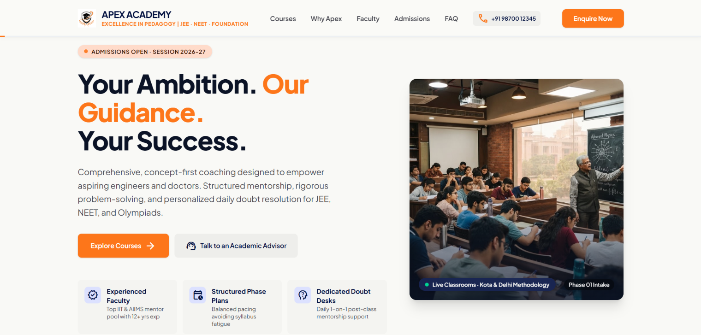
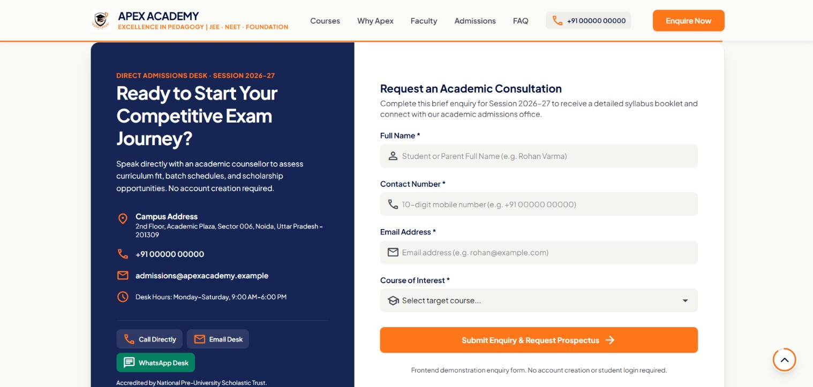

  # Apex Academy

  Apex Academy is a fictional coaching institute website built as a portfolio-style frontend project. The site is designed to showcase a premium academic brand for JEE, NEET, and Foundation coaching with a modern responsive interface, persuasive content, and a strong admissions-focused layout.

  ## Overview

  This project presents a complete coaching institute landing page with:

  - Hero section with admissions messaging
  - Programs section for JEE, NEET, and Foundation courses
  - Why Apex section highlighting methodology and learning approach
  - Campus environment and facility highlights
  - Faculty showcase and student trust section
  - FAQ and enquiry/admissions form
  - Contact and WhatsApp CTAs
  - Responsive navigation for mobile, tablet, and desktop
  - Scroll progress indicator and floating back-to-top button

  ## Project preview

  The following visuals capture the premium branding, admissions-focused landing page, and responsive desktop, tablet, and mobile experiences of Apex Academy.

  

    
  

  

    <table>
      <tr>
        <td></td>
      </tr>
    </table>
  

  ## Brand and site data

  The data in the site is aligned to the current demo build:

  - Brand name: Apex Academy
  - Tagline: Excellence in Pedagogy | JEE · NEET · Foundation
  - Admission session: 2026-27
  - Phone: +91 90123 41234
  - Email: admissions@apexacademy.example
  - WhatsApp: +91 90123 41234
  - Address: 2nd Floor, Academic Plaza, Sector 006, Noida, Uttar Pradesh – 201309
  - Working hours: Monday–Saturday, 9:00 AM–6:00 PM

  ## Course offerings shown on the website

  - JEE Main & Advanced
  - NEET Preparation
  - Foundation Courses

  ## Tech stack

  - React
  - TypeScript
  - Vite
  - Tailwind CSS
  - Lucide-based icons and custom UI styling

  ## Project Purpose

  This project demonstrates my ability to design and build responsive marketing websites for coaching institutes and similar businesses.
  The design and content can be customized to suit the branding and requirements of a real client.

  ## Run locally

  1. Install dependencies:
     npm install

  2. Start the development server:
     npm run dev

  3. Open the site in a browser:
     http://localhost:3000

  ## Production build

  To build the site for production:

  npm run build

  To preview the production build locally:

  npm run preview

  ## Deployment

  This frontend can be deployed as a static site on platforms such as:

  - Vercel
  - Netlify
  - GitHub Pages (configure Vite's `base` path for the repository)

  ## Disclaimer

  Apex Academy is a fictional institute created for demonstration purposes. The contact information and enquiry flow are sample data intended for portfolio presentation and do not represent a real institution or live admissions system.
